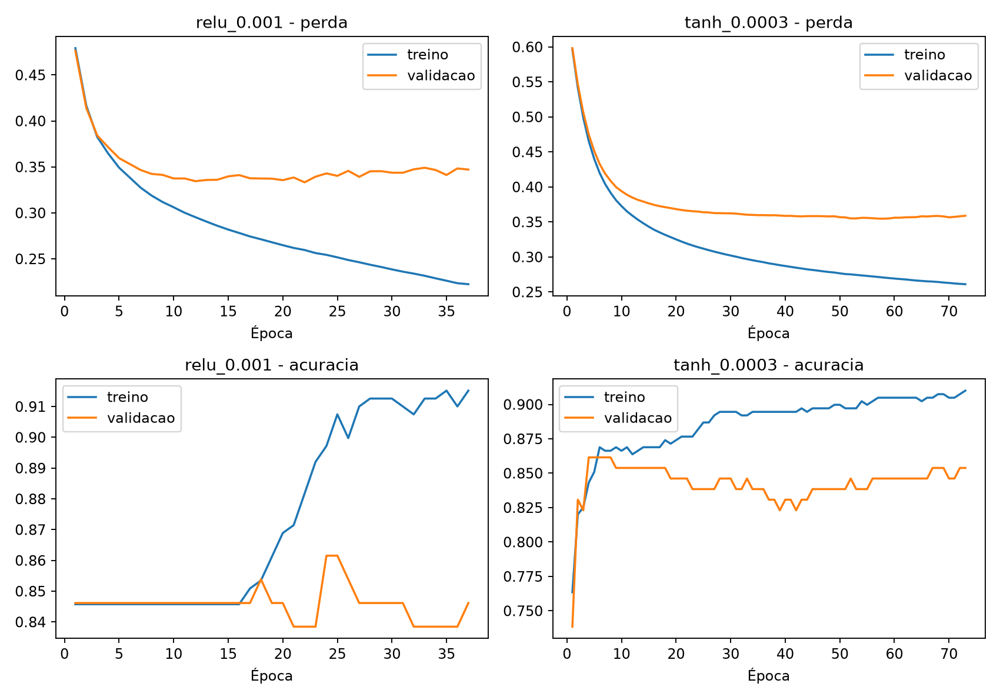

# Predição do rendimento acadêmico com MLP

Trabalho da disciplina **Sistemas Inteligentes**, do curso de Ciência da Computação da Universidade Positivo.

**Integrantes:** Leonardo Teles e Murilo dos Santos  
**Professora:** Malga Costa

## Objetivo

Comparar redes neurais multicamadas com as funções de ativação ReLU e Tanh na classificação da aprovação em Língua Portuguesa. O projeto utiliza informações do contexto escolar e familiar, sem incluir as notas dos períodos anteriores como entradas do modelo.

## Dataset

Foi utilizado o arquivo `student-por.csv`, da base [Student Performance, da UCI](https://archive.ics.uci.edu/dataset/320/student-performance).

- 649 registros de estudantes de duas escolas portuguesas.
- Dados coletados no ano letivo de 2005–2006.
- 33 colunas no arquivo original e 12 atributos selecionados como entradas.
- Nenhum valor ausente ou registro integralmente duplicado identificado.
- Alvo: aprovação quando a nota final `G3` é maior ou igual a 10, na escala de 0 a 20.

A base contém 549 aprovados e 100 reprovados. As variáveis `G1`, `G2` e o total de faltas não foram utilizadas como entradas. `G3` foi utilizada apenas para definir a classe.

## Metodologia

Os dados foram separados em treino, validação e teste, com estratificação e semente 42: 389 registros para treino, 130 para validação e 130 para teste. A padronização das variáveis numéricas e a codificação das categóricas foram ajustadas somente no treino.

| Parâmetro | Configuração |
| --- | --- |
| Biblioteca | TensorFlow/Keras |
| Camadas ocultas | 32, 16 e 8 neurônios |
| Ativações comparadas | ReLU e Tanh |
| Saída | Um neurônio com sigmoid |
| Otimizador | Adam |
| Taxas de aprendizado | 0,001 e 0,0003 |
| Tamanho do lote | 32 |
| Limite de épocas | 120 |
| Parada antecipada | 15 épocas sem redução da perda de validação |
| Função de perda | Entropia cruzada binária |

A configuração foi escolhida pela menor perda na validação, com restauração dos pesos da melhor época. O teste foi utilizado somente para a avaliação final. Os vetores de erros por lote e os históricos por época estão registrados nos arquivos CSV.

## Resultados

Resultados no conjunto de teste para a melhor taxa de cada ativação:

| Modelo | Acurácia | Acurácia balanceada | F1 macro | Recall da reprovação | ROC AUC |
| --- | ---: | ---: | ---: | ---: | ---: |
| ReLU — taxa 0,001 | 83,08% | 51,14% | 0,4951 | 5,00% | 0,7209 |
| Tanh — taxa 0,0003 | 80,00% | 55,45% | 0,5601 | 20,00% | 0,7268 |
| Baseline majoritária | 84,62% | 50,00% | 0,4583 | 0,00% | 0,5000 |

A ReLU com taxa 0,001 foi selecionada pela validação. Nenhuma rede superou a baseline em acurácia geral. Entretanto, a baseline sempre prevê aprovação e não identifica reprovados. Dos 20 reprovados no teste, a ReLU identificou 1 e a Tanh identificou 4.

O desequilíbrio entre as classes limita a interpretação da acurácia isolada. Os resultados indicam dificuldade na identificação de estudantes reprovados e não justificam o uso do modelo para decisões automáticas. A amostra histórica, de apenas duas escolas portuguesas, também limita a generalização.



## Arquivos principais

| Arquivo | Conteúdo |
| --- | --- |
| `rendimento_academico.py` | Preparação dos dados, treinamento e avaliação |
| `atualizar_relatorio.py` | Geração do PDF a partir dos resultados salvos |
| `requirements.txt` | Dependências do projeto |
| `config.json` | Identificação usada no relatório |
| `student-por.csv` | Dataset utilizado |
| `student.txt` | Documentação original dos dados |
| `metricas_teste.csv` | Métricas da avaliação final |
| `comparacao_validacao.csv` | Comparação das quatro configurações |
| `historico_*.csv` | Perda e acurácia por época |
| `erros_*.csv` | Resíduos por amostra em cada lote |
| `previsoes_*.csv` | Classes reais, probabilidades e previsões no teste |
| `modelo_*.keras` | Modelos treinados |
| `versoes.json` | Versões registradas na execução e modelo selecionado |
| `Relatorio_Rendimento_Academico.pdf` | Relatório técnico com metodologia, resultados e discussão |

## Execução

No Windows, com Python instalado, crie um ambiente virtual na pasta do repositório e instale as dependências:

```powershell
python -m venv .venv
.\.venv\Scripts\python.exe -m pip install -r requirements.txt
```

Para executar um novo treinamento:

```powershell
.\.venv\Scripts\python.exe rendimento_academico.py
```

Essa execução baixa o dataset da UCI e grava os resultados na subpasta `entrega_rendimento`, além de gerar um ZIP. É necessária conexão com a internet para o download inicial.

Para gerar novamente o relatório usando os resultados já presentes na raiz do repositório, sem treinar as redes:

```powershell
.\.venv\Scripts\python.exe atualizar_relatorio.py
```

## Referências

CORTEZ, Paulo; SILVA, Alice. *Using data mining to predict secondary school student performance*. Proceedings of the Fifth Annual Future Business Technology Conference. Porto: EUROSIS, 2008. p. 5–12.

CORTEZ, Paulo. *Student Performance*. UCI Machine Learning Repository, 2008. DOI: [10.24432/C5TG7T](https://doi.org/10.24432/C5TG7T). Dataset disponibilizado sob licença CC BY 4.0.
